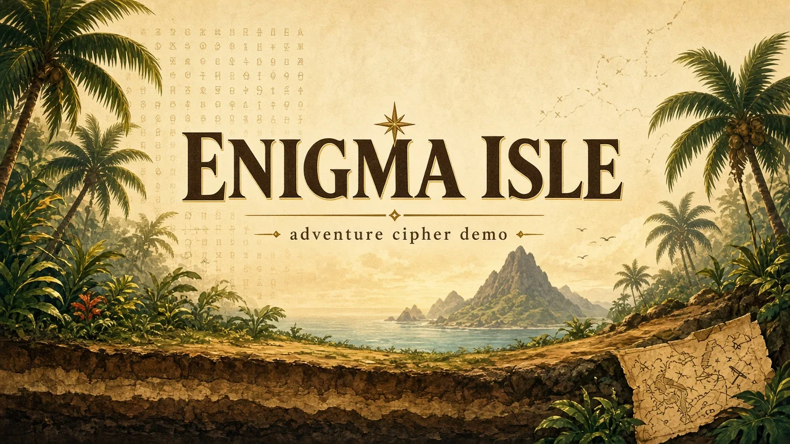

<div align="center">

<p>
  
</p>

# Enigma Isle

### A one-page island scroll landing with a client-side invertible cipher you can teach from.

**Encrypt and decrypt in the browser — SnapTrips-style hero art, step cards, and dirt-strata results — built as a college final with Interpretable Context Methodology (ICM).**

[](https://vitejs.dev)
[](https://react.dev)
[](https://www.typescriptlang.org)
[](https://tailwindcss.com)
[](https://www.framer.com/motion/)
[](https://vitest.dev)
[](https://playwright.dev)
[](https://vercel.com)

<br/>

[Features](#features) · [Quick start](#quick-start) · [Stack](#stack) · [Project structure](#project-structure) · [Cipher note](#cipher-note) · [Deploy](#deploy) · [FAQ](#faq)

<br/>

<code>git clone &lt;this-repo&gt; && cd Enigma-Isle && npm install && npm run dev</code>

</div>

---

> [!IMPORTANT]
> **Educational demo, not production crypto.** Enigma Isle implements a **bijective teaching cipher** (5-column grid + directional steps) so encrypt and decrypt round-trip in the UI. It is **not** vetted for secrecy, key management, or threat models — use it to explain invertibility, not to protect real data.

---

## Features

<table>
  <tr>
    <td width="50%" valign="top">
      <strong>Hero workbench</strong><br/>
      Wide plaintext input, encrypt/decrypt switch, yellow/green actions, white fade over painted island art, results expanding into brown dirt strata (<code>#3c2820</code> seam — no CSS wave clip).
    </td>
    <td width="50%" valign="top">
      <strong>Live cipher engine</strong><br/>
      Pure TypeScript in <code>src/lib/cipher/</code> — A–Z plus 0–9 (letter pipeline + 2×5 digit grid); Vitest and spec in <code>stages/03-cipher-spec/</code>.
    </td>
  </tr>
  <tr>
    <td valign="top">
      <strong>Teaching journey</strong><br/>
      About section with ABCD table, encrypt/decrypt step cards, quiet bridge to footer, island footer — clear English copy; island theme is visual only.
    </td>
    <td valign="top">
      <strong>ICM stage pipeline</strong><br/>
      Context lives in staged folders (discovery → design → cipher spec → build → polish), ADRs in <code>decisions/</code>, not only in chat — see <a href="CONTEXT.md">CONTEXT.md</a>.
    </td>
  </tr>
</table>

| Area | What you get |
|------|----------------|
| **Motion** | Framer Motion with reduced-motion respect |
| **Assets** | WebP-only art (`public/images/*.webp`) — hero, dirt, strata, parchment, mascot, footer |
| **Quality** | Vitest cipher tests · Playwright desktop + mobile E2E |
| **Host target** | Static Vite build → Vercel |

---

## Quick start

**Requirements:** Node.js 20+ (LTS recommended), npm 10+

```bash
git clone <this-repo>
cd Enigma-Isle
npm install
npm run dev          # http://localhost:5173
```

| Command | Purpose |
|---------|---------|
| `npm run dev` | Vite dev server |
| `npm run build` | `tsc` + production bundle → `dist/` |
| `npm run preview` | Serve the production build locally |
| `npm test` | Vitest (cipher unit tests) |
| `npm run test:e2e` | E2E — desktop (1280px) and mobile (390px) |

First-time Playwright browsers:

```bash
npx playwright install
```

---

## Stack

| Layer | Choice |
|-------|--------|
| Build | [Vite](https://vitejs.dev) 8 |
| UI | [React](https://react.dev) 19 + [TypeScript](https://www.typescriptlang.org) 7 |
| Styling | [Tailwind CSS](https://tailwindcss.com) 4 |
| Motion | [Framer Motion](https://www.framer.com/motion/) |
| Icons / UI primitives | Lucide, shadcn-style utilities |
| Tests | [Vitest](https://vitest.dev) · [@playwright/test](https://playwright.dev) |
| Cipher | Client-only TS — no server round-trip |

Locked in [decisions/001-stack-vite-react-ts.md](decisions/001-stack-vite-react-ts.md).

---

## Project structure

```
enigma/
├── docs/assets/          README banner (SVG source + WebP for GitHub)
├── public/images/        WebP island / UI art
├── src/
│   ├── components/       Nav, hero, journey cards, footer
│   ├── hooks/            Cipher + motion preferences
│   └── lib/cipher/       Encrypt, decrypt, grid, tests
├── stages/
│   ├── 01-discovery/     Research + references
│   ├── 02-design/        IA, tokens, section specs
│   ├── 03-cipher-spec/   Formal algorithm + test vectors
│   ├── 04-build/         Implementation notes
│   └── 05-polish/        Motion, a11y, deploy polish
├── decisions/            Numbered ADRs (stack, brand, cipher, hero seam)
└── design-system/        Tokens and theme
```

Entry points:

- [CONTEXT.md](CONTEXT.md) — goals, hero UX, stage status  
- [decisions/](decisions/) — numbered architecture decisions  

Private agent notes (`docs/PLAN.md`, build logs, QA shots, prompts) stay local and are gitignored.

---

## Cipher note

The algorithm is documented in [stages/03-cipher-spec/output/cipher-spec.md](stages/03-cipher-spec/output/cipher-spec.md):

- Letters **A–Z** (uppercase output) and digits **0–9**; spaces preserved; other symbols stripped.
- **Step 1–2:** Bijective cyclic walk (×18 step count from letter value).
- **Step 3:** Column shift **down 13×** (mod column length); decrypt uses **up 13×**.
- **Step 4:** Grid finisher `up → left → up → right×2` with defined wraps.
- Locked vectors (Vitest): `HELLO` → `CZUUA`, `SWORD` → `DQAJE` — see [test-vectors.json](stages/03-cipher-spec/output/test-vectors.json) and [ADR 005](decisions/005-column-shift-13.md).

Run `npm test` (Vitest unit tests) for round-trips. Treat output as a **classroom invertibility demo**, not a substitute for modern cryptography.

---

## Deploy

Static export via Vite:

```bash
npm run build
```

| Setting | Value |
|---------|--------|
| Framework preset | Vite |
| Output directory | `dist` |
| Install | `npm install` |
| Build command | `npm run build` |

Host target: **Vercel**. No secrets required — cipher runs entirely in the browser.

---

## FAQ

<details>
<summary><b>Does this send my text to a server?</b></summary>
<br/>

No. Encryption and decryption run in the browser from <code>src/lib/cipher/</code>. Deploying to Vercel serves static assets only.
</details>

<details>
<summary><b>Why “invertible” instead of “secure”?</b></summary>
<br/>

The course goal is a working <strong>encrypt and decrypt</strong> pair with an explainable grid story. Security properties (entropy, keys, side channels) are out of scope; the README callout above applies.
</details>

<details>
<summary><b>What is ICM?</b></summary>
<br/>

<strong>Interpretable Context Methodology</strong> — project context is staged under <code>stages/</code> and <code>decisions/</code> so humans and agents can resume work without re-deriving the whole plan from chat history.
</details>

<details>
<summary><b>Why WebP banner instead of SVG?</b></summary>
<br/>

GitHub’s image proxy (Camo) often strips or fails SVG in READMEs. Vector source lives at <code>docs/assets/enigma-isle-banner.svg</code>; the README embeds the WebP raster.
</details>

---

<div align="center">

**Enigma Isle** — college final · island scroll · teachable cipher · client-side only.

</div>
